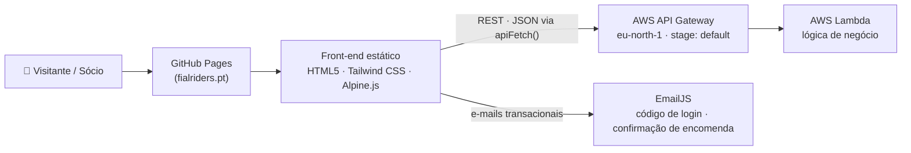

<div align="center">
  
  <br>
  <h1>Fial Riders — Website Oficial</h1>
  <p>
    Site do <a href="https://fialriders.pt">Motoclube Fial Riders</a> com área de sócio, loja de merchandising,<br>
    eventos, galerias e inscrições online — servido por uma API serverless em AWS.
  </p>
  <p><em>Official website of the Fial Riders motorcycle club: member area, merch store, events and<br>photo galleries, powered by a serverless AWS API.</em></p>
  <p>
    <a href="https://fialriders.pt"></a>
    
    
    
    
    
    
  </p>
</div>

## 📖 Sobre o projeto

Website institucional e plataforma de sócio do Motoclube Fial Riders — **projeto real, em produção** no domínio [fialriders.pt](https://fialriders.pt), com produtos, eventos e sócios verdadeiros.

É uma aplicação **100% estática** (servida pelo GitHub Pages, sem processo de build) que consome uma **API REST serverless em AWS** (API Gateway + Lambda) para todo o conteúdo dinâmico: carrossel, parceiros, catálogo da loja, eventos, galerias, autenticação de sócio, inscrições e encomendas.

> 🚧 **Em melhoria ativa:** o site está em produção e o projeto encontra-se num processo contínuo de endurecimento de segurança, refactoring e automatização — o ponto de situação está na secção **🗺️ Roadmap de melhorias**, no fim deste documento.

## ✨ Funcionalidades

| Página | Funcionalidades |
|---|---|
| `index.html` — Home | Carrossel dinâmico, ticker de parceiros, login de sócio, atalho de inscrição |
| `QuemSomos.Html` | História do clube + galeria de fotos |
| `Camisolas.Html` — Loja | Catálogo vindo da API, preços distintos sócio/público, carrinho persistente, checkout com registo de encomenda no backend + email de confirmação (EmailJS) |
| `Eventos.Html` | Agenda de eventos em tempo real, com ligação à galeria de cada evento |
| `FotoEventos.Html` | Álbuns fotográficos por evento, navegáveis por parâmetro de URL (`?evento=`) |
| `FazSocio.html` | Ficha de inscrição de novo sócio submetida à API |
| `Contactos.Html` | Formulário de contacto, mapa e redes sociais |

**Transversal:**
- 🔐 **Login de sócio em dois passos** — nº de sócio + email → código de verificação enviado por email
- 🛡️ **Resiliência** — o wrapper `apiFetch()` centraliza autenticação e erros; overlay de manutenção automático quando a API falha ou devolve 403
- 🛒 **Estado no cliente** — sessão e carrinho guardados em `localStorage`, com limpeza do carrinho no login/logout

## 🧱 Arquitetura



O acesso à API é restringido por **CORS allowlist** à origem `https://fialriders.pt` — pedidos de outras origens (incluindo `localhost`) são recusados pelo browser.

### Configuração da API

O URL da API está declarado diretamente no JavaScript de cada página que consome a API. Como o frontend é estático, esse endereço é público e pode ser visto pelos visitantes; não coloques chaves privadas ou credenciais no HTML. A autenticação, autorização e validação dos pedidos devem ser feitas no backend.

## 🗂️ Estrutura do projeto

```
FialRidersBTH/
├── index.html          # Homepage — carrossel e parceiros
├── QuemSomos.Html      # Sobre o clube + galeria
├── Camisolas.Html      # Loja — carrinho e checkout
├── Eventos.Html        # Agenda de eventos
├── FotoEventos.Html    # Galerias por evento
├── FazSocio.html       # Inscrição de novo sócio
├── Contactos.Html      # Contactos + mapa + redes
├── assets/
│   └── img/            # Logótipo e imagens do site
├── CNAME               # Domínio próprio do GitHub Pages (fialriders.pt)
├── .gitignore
└── README.md
```

> ℹ️ Os nomes das páginas mantêm a capitalização original (ex.: `Eventos.Html`) para preservar os URLs públicos já indexados pelo Google.

## 🔧 Decisões técnicas

- **Zero build** — Tailwind CSS e Alpine.js via CDN; o site pode ser servido estaticamente pelo GitHub Pages ou localmente com `npm start`.
- **`apiFetch()`** — wrapper único de acesso à API: injeta o token Bearer da sessão e o header `x-origem-fialriders` (validado pelo backend), define o `Content-Type` e centraliza o tratamento de erros (403 → overlay de manutenção).
- **Sessão e carrinho em `localStorage`** — sem backend de estado, com limpeza automática no login/logout para não misturar encomendas entre utilizadores.
- **Preços de sócio protegidos** — o preço de sócio só é revelado no cliente após autenticação; a validação final é sempre do lado do backend.

## 🗺️ Roadmap de melhorias

Projeto entregue e em produção, numa fase de **evolução ativa** — que inclui uma auditoria de segurança completa já realizada à superfície pública da API. As frentes de trabalho atuais:

**✅ Concluído recentemente**
- [x] Organização e documentação do repositório (estrutura, `.gitignore`, este README)
- [x] Auditoria de segurança à superfície pública da API
- [x] Correções de navegação e de experiência de utilização na loja

**🚧 Em curso**
- [ ] Endurecimento de segurança do backend (autenticação e proteção contra abuso)

**📋 Planeado**
- [ ] Refactoring do frontend (remoção de duplicação de lógica entre páginas)
- [ ] Testes automatizados e CI
- [ ] Deploy as-code e avaliação de base de dados gerida
- [ ] Screenshots das páginas neste README

## 👤 Autor

<p align="center">
  <sub>Desenvolvido por <a href="https://github.com/Gabriel0342"><b>Gabriel</b></a> para o <a href="https://fialriders.pt">Motoclube Fial Riders</a></sub><br>
  <sub>Instagram: <a href="https://www.instagram.com/fialridersbth">@fialridersbth</a> · TikTok: <a href="https://www.tiktok.com/@fial.riders.bthd">@fial.riders.bthd</a></sub><br><br>
  <sub>© Fial Riders — Todos os direitos reservados</sub>
</p>
